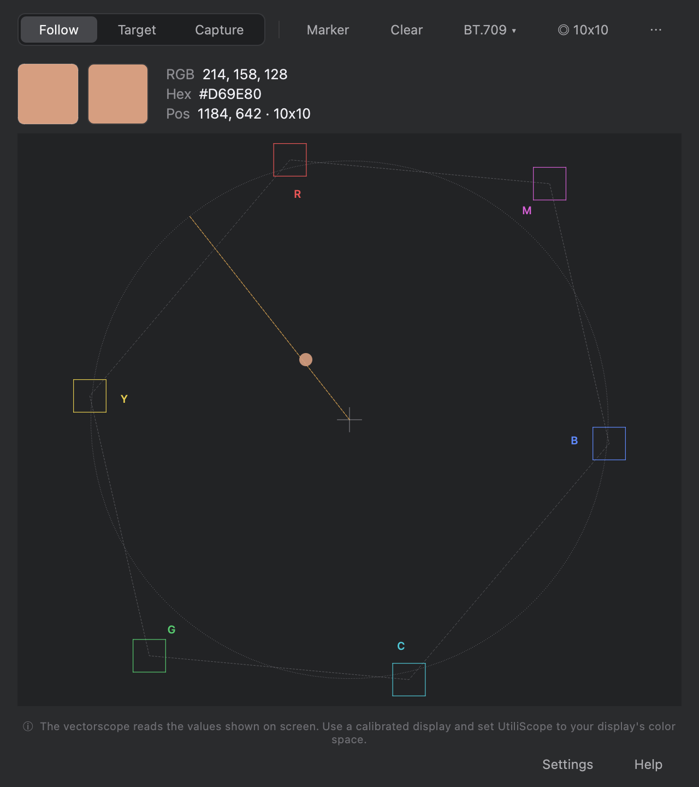

# UtiliScope — real-time vectorscope for macOS

**Check skin tones and color casts on anything on your screen** — Lightroom, Capture One, DaVinci Resolve, Premiere, your browser, a video call. UtiliScope floats above your apps (even full-screen ones) and reads the color under your cursor live.

**Free 7-day trial. Install in one command:**

```bash
curl -fsSL https://raw.githubusercontent.com/dmtlca1234/Utiliscope_public/main/install.sh | bash
```

<p align="center"></p>

*[Version française plus bas ↓](#français)*

## What it does

- **Live vectorscope** in BT.709, BT.601, BT.2020, DCI-P3 and ARRI, each with its own **skin tone line**.
- **RGB and hex readout** under the cursor, or locked on a fixed **Target** while you grade.
- **Capture** a wider area as a reference cloud, **markers** to match a series of images (export / import as JSON), 2× and 4× zoom for subtle skin tones.
- **Always on top**, keyboard shortcuts for everything, French and English interface.

UtiliScope reads the values shown on screen: use a calibrated display and set UtiliScope to your display's color space.

## Install

Paste the command above in **Terminal**. It:

1. downloads the latest release from this page;
2. checks its SHA-256 checksum, its Developer ID signature (STUDIO D MTL, team `4NP3FD6KS5`) and its **Apple notarization** — anything wrong and nothing is installed;
3. copies **UtiliScope Beta.app** to `/Applications` and opens it.

On first launch, choose **Free trial**. macOS asks for the **Screen Recording** permission: it is only used to read colors — nothing is recorded or sent.

Prefer clicking? Download the DMG from the [latest release](https://github.com/dmtlca1234/Utiliscope_public/releases/latest) and drag the app to Applications.

**Update:** run the same command again. **Uninstall:**

```bash
curl -fsSL https://raw.githubusercontent.com/dmtlca1234/Utiliscope_public/main/uninstall.sh | bash
```

(Your license stays activated on this Mac. Add `-s -- --purge` after `bash` to remove everything.)

## Requirements

macOS 14 Sonoma or later · Apple Silicon or Intel (universal app, runs natively).

## License

After the 7-day trial, **buy a license at [utiliscope.xyz](https://utiliscope.xyz/)** — one-time purchase, no subscription, one license per Mac. Paste your key in the app to activate it.

UtiliScope is proprietary software ([EULA](LICENSE.txt)). This repository only hosts the installer and the signed releases; the source code is not public.

## Feedback

Found a bug or have an idea? [Open an issue](https://github.com/dmtlca1234/Utiliscope_public/issues) or write to info@utiliscope.xyz. In the app, **Help → Send logs** prepares a diagnostic file you can attach.

---

## Français

**UtiliScope — vectorscope en temps réel pour macOS.** Vérifiez un teint ou une dominante sur n'importe quoi à l'écran : Lightroom, Capture One, DaVinci Resolve, Premiere, navigateur, appel vidéo. La fenêtre reste au-dessus de vos apps, même en plein écran.

**Essai gratuit de 7 jours. Installation en une commande** (à coller dans le Terminal) :

```bash
curl -fsSL https://raw.githubusercontent.com/dmtlca1234/Utiliscope_public/main/install.sh | bash
```

Le script télécharge la dernière version, vérifie son empreinte SHA-256, sa signature Developer ID et sa **notarisation Apple**, puis installe **UtiliScope Beta.app** dans `/Applications` et l'ouvre. Au premier lancement, choisissez **Essai gratuit**, puis autorisez « Enregistrement d'écran » (sert uniquement à lire les couleurs ; rien n'est enregistré ni envoyé).

- **Vectorscope** BT.709, BT.601, BT.2020, DCI-P3 et ARRI, avec ligne de peau.
- **Lecture RGB et hex** sous le curseur ou sur une cible fixe ; capture d'un nuage de référence ; marqueurs pour harmoniser une série d'images.
- UtiliScope lit les valeurs affichées à l'écran : utilisez un écran calibré et réglez UtiliScope sur l'espace couleur de votre écran.
- macOS 14 ou plus récent, Mac Apple Silicon et Intel.

**Mettre à jour :** relancez la même commande. **Désinstaller :**

```bash
curl -fsSL https://raw.githubusercontent.com/dmtlca1234/Utiliscope_public/main/uninstall.sh | bash
```

**Licence :** après l'essai, achetez une licence sur **[utiliscope.xyz](https://utiliscope.xyz/)** — achat unique, sans abonnement, une licence par Mac. Logiciel propriétaire ([CLUF](LICENSE.txt)) ; ce dépôt ne contient que l'installateur et les versions signées.

**Un bogue, une idée ?** [Ouvrez une issue](https://github.com/dmtlca1234/Utiliscope_public/issues) ou écrivez à info@utiliscope.xyz.

---

<sub>© 2026 STUDIO D MTL · [utiliscope.xyz](https://utiliscope.xyz/)</sub>
